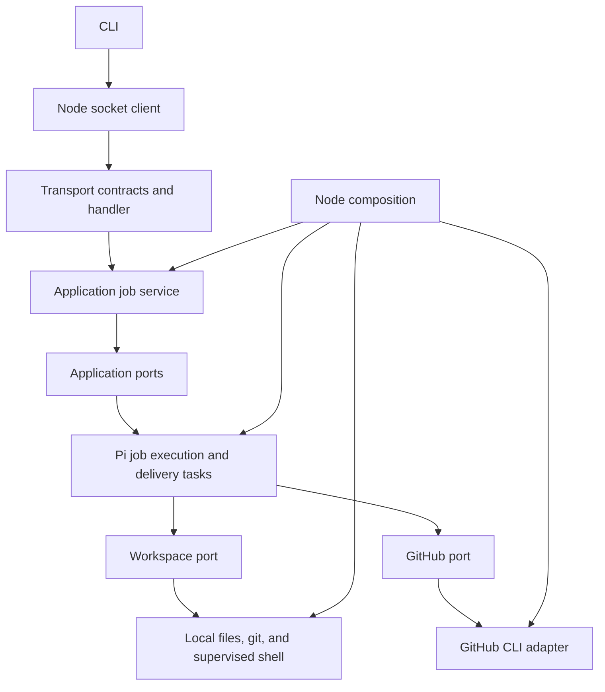

# V2 architecture

The package keeps delivery behavior separate from its local host. The public entry point is the CLI. Its commands use validated protocol contracts or call the Node composition functions for setup and preflight.

## Module ownership

| Directory        | Responsibility                                                                                                  |
| ---------------- | --------------------------------------------------------------------------------------------------------------- |
| `domain/`        | Configuration, job and review schemas, artifact contracts, and checkpoint invariants.                           |
| `application/`   | Preflight, admission, polling, timeout decisions, and capability interfaces.                                    |
| `adapters/pi/`   | Durable documents, atomic job admission, task ownership, generation, checkpoint transitions, and recovery.      |
| `adapters/node/` | Processes, local repositories, git, credentials, read-only environments, process supervision, and Unix sockets. |
| `transport/`     | Request/result schemas and exhaustive request dispatch.                                                         |
| `composition/`   | Construction of the working local runtime and ownership of its storage.                                         |
| `shared/`        | Small error and unknown-JSON helpers used across these boundaries.                                              |

Domain, application, and transport modules cannot import Node APIs, concrete adapters, composition modules, or Pi packages. ESLint enforces this rule. The Pi delivery task receives workspace and GitHub capabilities; it has no Node imports and does not construct local adapters.

The application owns scheduling policy. The Node daemon owns its timer and socket lifecycle. Pi owns task execution and atomic state commits. Job admission and creation of the task and its owning conversation remain one commit, preserving duplicate-run and global-width enforcement.

## Types and external data

Zod schemas define business records and infer their TypeScript types. Configuration, review output, GitHub JSON, credentials, process receipts, and protocol messages are validated where they enter the system. The socket client validates both the response envelope and the method's result before returning a typed value to the CLI. Unknown diagnostic task data remains explicitly `unknown`.

Delivery checkpoints form a discriminated union. A building checkpoint requires its builder ID. Commit requires PR metadata. Verify and publish require that metadata and a commit SHA. Review requires a published PR. Decide requires parsed findings. Finish requires a terminal outcome. Phase handlers are exhaustive and retain their narrowed checkpoint type; they do not use non-null assertions to infer that a preceding phase supplied a field.

Compiler checks cover source and tests. They include strict null checks, unchecked indexed access, exact optional properties, explicit type imports, unused declarations, implicit returns, switch fallthrough, overrides, and isolated modules. ESLint also checks floating promises and unsafe values. Prettier owns formatting.

## Persistence compatibility

`romp.state` and `romp.role` retain their document names, versions, and stored shape. The delivery task retains `romp.delivery` and advances its definition from version 1 to version 2. Its migration validates the original input and checkpoint against the current schemas before execution. Unsupported versions fail explicitly.

Recovery was checked against a real checkpoint produced by the original runtime at commit `9e4c797`, killed after PR creation. The refactored runtime migrated it, reused the existing PR, ran only the reviewer, and completed. A permanent SQLite migration test covers a pending version-one publication checkpoint.

## Cloudflare boundary

This refactor supplies replaceable host boundaries; it does not add a Cloudflare deployment. A Cloudflare host would construct Pi over Durable Object storage, implement workspace operations against a sandbox, and replace the Unix-socket transport, local repository resolution, credential storage, and polling wake mechanism. It must also coordinate persisted task checkpoints with recoverable workspace files. The existing Node host remains the runnable implementation.
